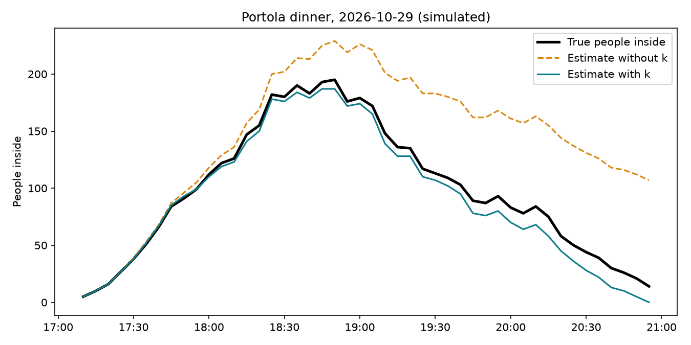

# UCSB Dining Tracker



A live "how full is it?" bar for UCSB's dining commons, built from a beam sensor on each hall's entrance and exit lane, an ESP32, and a small Python server.

**Live at https://ucsbdining.duckdns.org**

An unofficial student project, not affiliated with UCSB Housing, Dining & Auxiliary Enterprises. No sensors are installed in a dining hall yet, so the live site shows test data. Seat counts other than Portola's 600 are placeholders.

## How it works

- **Sense:** an IR beam across each lane. The entrance is single file through the ID check, so each break is one person. The ESP32 filters out blips (a swinging bag) and sends each person to the server over HTTPS (`door_sensor/`).
- **Store:** the server saves every raw event in SQLite rather than a running total, so history can be recomputed with a better formula later (`main.py`).
- **Correct:** people who leave side by side get counted as one exit, so the naive count drifts high. Each hall closes empty, so after each meal k = entries ÷ sensed exits, pooled over the last 10 meals of the same type. Live occupancy = entries − k × exits, kept between 0 and capacity.
- **Check:** `simulate.py` makes two weeks of fake meals where the true count is known. With 12% of exits hidden, it learns k = 1.134 (true value 1.136) and cuts the average error from 45 people to 7.
- **Show:** `index.html` asks the server for `/status` every second and draws a bar per hall.

## Tech

Python (FastAPI, SQLite), vanilla JavaScript, ESP32 (Arduino), Ubuntu VPS with Caddy for HTTPS.

## Run it locally

From the repo root (Windows):

```
python -m pip install -r requirements.txt
python -m uvicorn main:app --reload
```

Open http://127.0.0.1:8000. To make the bars move without hardware, run `python live_demo.py` in a second terminal. Outside meal hours every hall shows Closed; set `ALWAYS_OPEN = True` in `main.py` to test anytime.

`python simulate.py` fills `dining.db` with fake meals and grades the formula (add `matplotlib` for the chart). It deletes events in the dates it simulates, so don't run it on real data.

## ESP32

Copy `door_sensor/secrets.example.h` to `door_sensor/secrets.h` and fill in your Wi-Fi, server address and API key. Then open `door_sensor/door_sensor.ino` in Arduino IDE, choose **ESP32 Dev Module** (the classic ESP32, not C3/S3), and upload. A push button or the beam receiver goes between GPIO 4 and GND.

## Deploy

On a fresh Ubuntu 24.04 VPS with a domain pointing at it, copy the repo up and run:

```
bash deploy/setup.sh your-domain.example.com
```

It installs Caddy (HTTPS), turns on the firewall, sets the clock to Pacific time, makes a random API key in `/etc/dining.env`, and runs the app as a systemd service that restarts on crashes and reboots.

## Files

| Path | What it is |
|---|---|
| `main.py` | The server: events in, occupancy out |
| `index.html` | The live webpage |
| `simulate.py` | Fake meals with a known true count, to grade the formula |
| `live_demo.py` | Pretends to be the sensors, for testing the page |
| `door_sensor/` | ESP32 program and settings template |
| `deploy/` | VPS setup script and systemd service |
